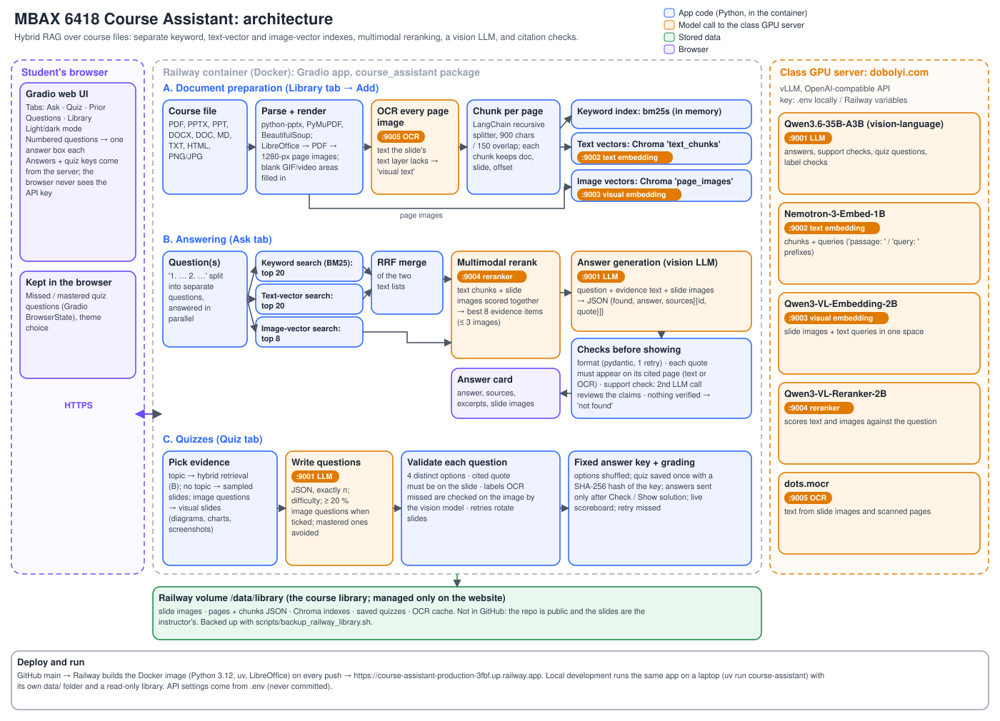
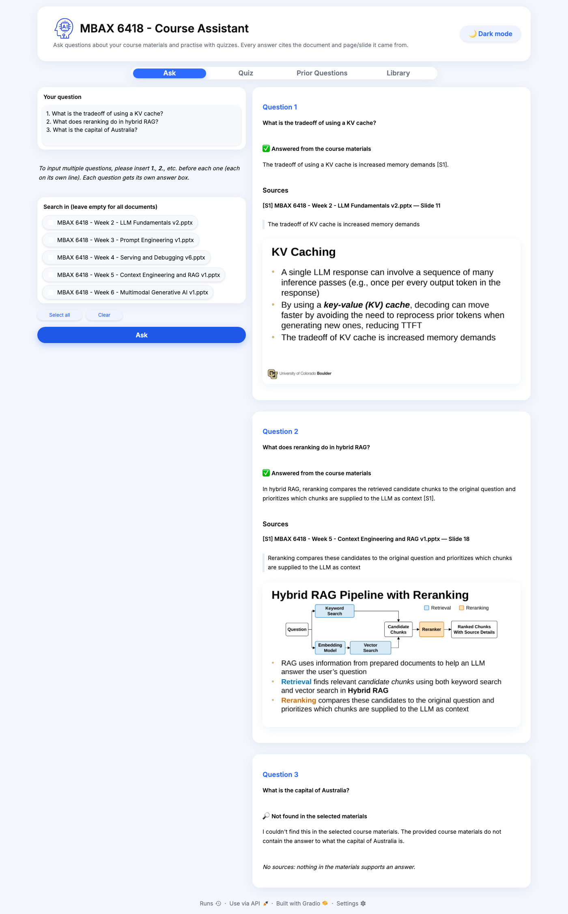
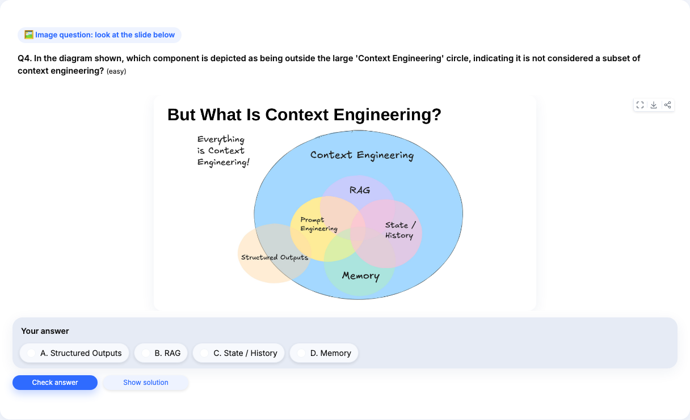
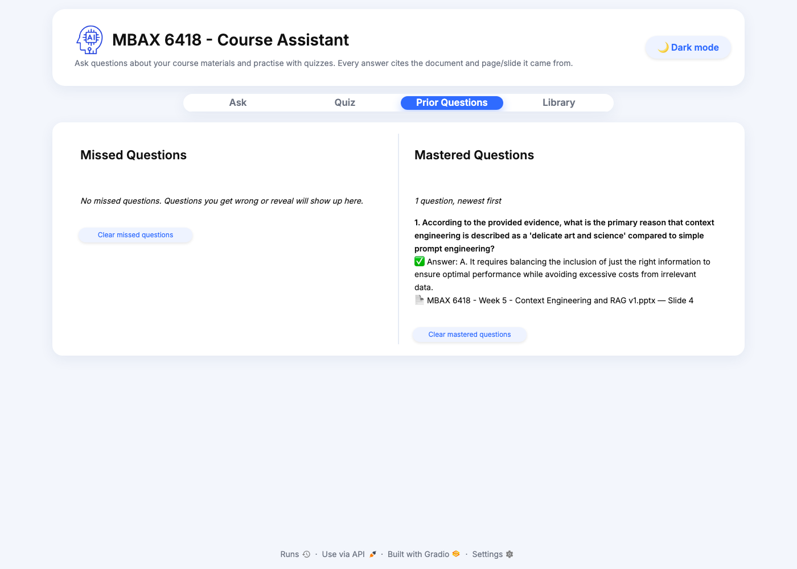
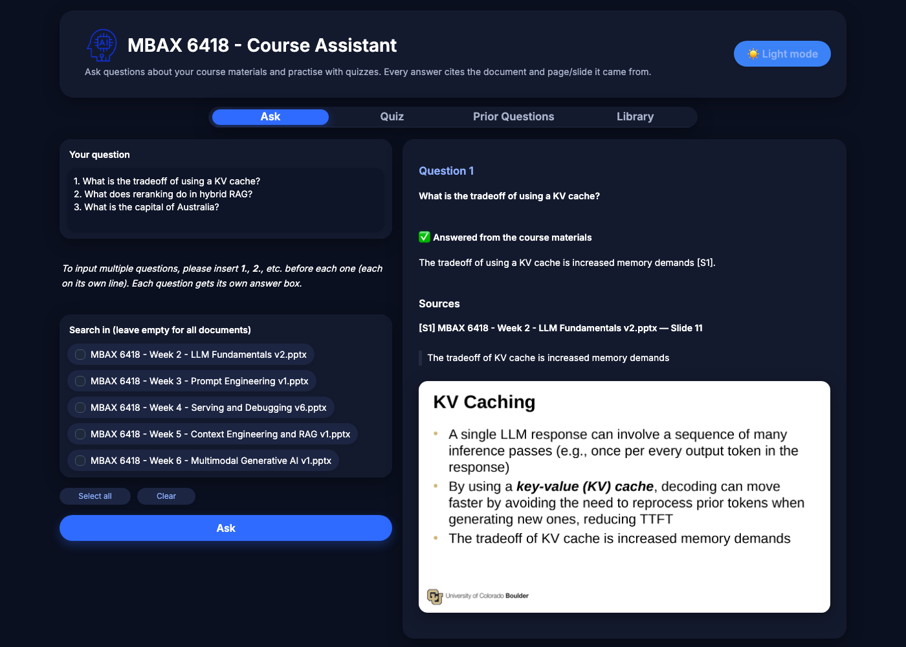

# MBAX 6418 Course Assistant: Q&A and Practice Quizzes from Course Materials

**MBAX 6418, Assignment 2** · Live app: **https://course-assistant-production-3fbf.up.railway.app**

A Python + Gradio app that answers questions about course materials (slides, syllabus, and other Canvas downloads) and generates multiple-choice practice quizzes from them. Every answer and every quiz explanation shows the **document**, the **page/slide**, a **quoted excerpt**, and the **original slide image**. When the materials don't contain the answer, the app says so instead of guessing.

The app uses **hybrid RAG** (retrieval-augmented generation: find the relevant material first, then have the model answer only from it):
- three separate indexes: keyword search, text embeddings and slide-image embeddings;
- a multimodal reranker that scores the combined results;
- a vision-capable LLM that writes the answer;
- checks on every citation before an answer is shown.

| An answer with its supporting slide image | Quiz feedback with its source |
|---|---|
|  |  |

---

## Contents
- [Repository contents](#repository-contents)
1. [What the app does](#1-what-the-app-does)
2. [Setup and use](#2-setup-and-use)
3. [Architecture](#3-architecture)
4. [Evaluating answer quality: results and findings](#4-evaluating-answer-quality-results-and-findings)
5. [Known limitations](#5-known-limitations)
6. [More screenshots](#6-more-screenshots)
7. [Working on this as a team](#7-working-on-this-as-a-team)
8. [Glossary](#8-glossary)

---

## Repository contents

| Required item | Where it is |
|---|---|
| **Code** | [`course_assistant/`](course_assistant): the app (ingestion, chunking, indexes, retrieval, answers, quizzes, model-service clients, Gradio interface) · [`scripts/`](scripts): folder ingest, UI walkthrough, diagram generator, Railway deploy/backup/seed · [`eval/`](eval): benchmark and comparison scripts · [`tests/`](tests): 73 offline + 4 live tests · [`Dockerfile`](Dockerfile): the server image |
| **README and other documentation** | this README (setup and use, architecture, results, limitations) · [`.env.example`](.env.example) (every setting, explained) · docstrings at the top of each module and script · [GitHub issues](https://github.com/kritter6754/assignment2_MBAX6418/issues) (open work with completion checks) |
| **SVG architecture diagram** | [`docs/architecture.svg`](docs/architecture.svg), embedded in [section 3](#3-architecture); generated by [`scripts/make_architecture_svg.py`](scripts/make_architecture_svg.py) |
| **Screenshots** | [`docs/screenshots/`](docs/screenshots): answer with its slide image, quiz feedback with sources, several numbered questions, an image question, Prior Questions, Library, dark mode ([section 6](#6-more-screenshots)) |
| **Saved results** | [`results/`](results): [`summary.md`](results/summary.md) + [`eval_results.json`](results/eval_results.json) (benchmark, every question's outcome) · [`prefix_ablation.json`](results/prefix_ablation.json) (design comparison) · [`variation.md`](results/variation.md) + [`variation.json`](results/variation.json) (3 repeat runs) · benchmark questions in [`eval/questions.jsonl`](eval/questions.jsonl) |
| **Dependencies** | [`pyproject.toml`](pyproject.toml) (Python packages) · [`uv.lock`](uv.lock) (exact pinned versions) · [`.python-version`](.python-version) (Python 3.12) · LibreOffice (system install, [section 2.1](#21-install)) |
| **Configuration instructions** | [section 2.2](#22-configure-the-endpoints) (endpoints and key) · [`.env.example`](.env.example) (copy to `.env`) · [section 2.9](#29-operating-the-live-app) (live app settings) |

Not in the repo, on purpose: `.env` (the API key), the course slides and the processed library (`data/`, `backups/`). The repo is public and the slides are the instructor's material.

---

## 1. What the app does

| Tab | What a student can do |
|---|---|
| **Ask** | Ask about all documents, or only the ones ticked (with **Select all** / **Clear**). Each answer is short, with `[S1]`-style markers, and every cited source shows the document, slide/page, quoted excerpt and original slide image. To ask several things at once, number them `1.`, `2.`, `3.`: each question gets its own answer box. If the materials don't cover a question, the box says it couldn't find it. |
| **Quiz** | Pick documents, optionally add a topic and a difficulty (mixed / easy / medium / hard), and choose 1–20 questions. Tick **Produce questions with viewable images** and at least 20% of the questions (rounded up) ask about a diagram, chart, table or screenshot shown with the question. Solutions stay hidden until **Check answer** or **Show solution**. Feedback shows right/wrong, an explanation, the source excerpt and the source slide. A live scoreboard counts correct, incorrect and finished questions. **Retry missed questions** re-asks the ones you got wrong. |
| **Prior Questions** | Two lists, kept in your browser: **Missed Questions** (with the right answer, your answer and the source) and **Mastered Questions**. A missed question moves to mastered once you answer it correctly, and new quizzes don't repeat mastered questions. |
| **Library** | Add and remove course files (on the live app), see which formats are accepted and any processing warnings, and browse any page or slide: the original image next to the exact text extracted from it. |

A dark/light mode button sits in the header.

---

## 2. Setup and use

### 2.1 Install

Requires [uv](https://docs.astral.sh/uv/), which installs Python 3.12 for you, and LibreOffice, which renders PowerPoint/Word files as slide images.

```bash
git clone https://github.com/kritter6754/assignment2_MBAX6418.git
cd assignment2_MBAX6418
uv sync                                  # Python dependencies

brew install --cask libreoffice          # macOS
# sudo apt install libreoffice           # Ubuntu/Debian
```

### 2.2 Configure the endpoints

```bash
cp .env.example .env      # then edit .env
```

`.env` is git-ignored. **Never commit it**, and never paste the key into code, issues, screenshots or chat. `.env.example` has dummy values only.

| Variable | Class service (`dobolyi.com`, vLLM, OpenAI-compatible) | Model |
|---|---|---|
| `CLASS_API_KEY` | key for all five services | – |
| `LLM_BASE_URL`, `LLM_MODEL` | `:9001`, vision-capable LLM: answers, support checks, quiz questions | Qwen3.6-35B-A3B |
| `TEXT_EMBED_BASE_URL`, `TEXT_EMBED_MODEL` | `:9002`, text embeddings | Nemotron-3-Embed-1B |
| `VISUAL_EMBED_BASE_URL`, `VISUAL_EMBED_MODEL` | `:9003`, image + text embeddings in one space | Qwen3-VL-Embedding-2B |
| `RERANK_BASE_URL`, `RERANK_MODEL` | `:9004`, multimodal reranker | Qwen3-VL-Reranker-2B |
| `OCR_BASE_URL`, `OCR_MODEL` | `:9005`, document parsing / OCR | dots.mocr |
| `TEXT_EMBED_QUERY_PREFIX`, `TEXT_EMBED_PASSAGE_PREFIX` | defaults `"query: "` / `"passage: "`. These matter a lot; see [findings](#43-interpretation) | – |
| `READ_ONLY` | `true` hides Add/Remove (our local setting: the shared library is edited only on the live app) | – |

### 2.3 Launch

```bash
uv run course-assistant        # opens on http://127.0.0.1:7860
```

To build a **local** library from a folder of Canvas downloads, set `READ_ONLY=false` in `.env`, then run:

```bash
uv run python scripts/ingest_folder.py ~/path/to/Canvas/downloads
```

Processing the five course decks (142 slides) takes about 3 minutes, mostly OCR and image embeddings. A typical answer takes 2–4 seconds; a 5-question quiz about 10 seconds.

**The live app** (https://course-assistant-production-3fbf.up.railway.app) runs the same code on Railway. Every push to `main` on GitHub rebuilds and redeploys it. It has no login page.

### 2.4 Add and remove documents

- **On the live app (the shared course library):** Library tab → drop files on **Add course files** → **Add to library**. A ⏳ timer counts up while the file is processed. To remove a document, pick it under **Remove a document** → **Remove**. Changes are saved on the server's storage volume. Anyone with the link can do this; setting a `LIBRARY_PASSWORD` variable on Railway turns on a password check.
- **Re-adding the same file** is detected (same content → same document) and skipped. Remove it first to re-process it.
- **Keep a copy:** `scripts/backup_railway_library.sh` downloads the live library to `backups/`.

### 2.5 Ask questions

1. Type a question, or several numbered ones, each on its own line:
   ```
   1. What is the tradeoff of using a KV cache?
   2. What does reranking do in hybrid RAG?
   ```
   The list must start at `1.` and count up. A `2.` inside a question (e.g. "GPT-5.2") doesn't split it. Enter adds a new line; press **Ask** to submit. Up to 10 questions at a time.
2. Optionally tick documents to search (empty = all).
3. Each answer box shows one of:
   - ✅ **Answered from the course materials**
   - ⚠️ **Answer only partly verified** (the support check flagged a claim; see the notes)
   - 🔎 **Not found in the selected materials**

### 2.6 Generate quizzes

Quiz tab → tick material (or **Select all**) → optional topic → difficulty → number of questions (1–20) → optionally **Produce questions with viewable images** → **Generate quiz**. Answer each question with **Check answer**, or use **Show solution**; revealed questions count as incorrect. **Retry missed questions** builds a new quiz from the ones you missed. The Prior Questions tab keeps your missed and mastered lists across visits in the same browser.

### 2.7 Supported formats and manual conversion

| Format | What is kept |
|---|---|
| `.pptx` | Slide titles, text, tables, **speaker notes**, plus an image of every slide (rendered with LibreOffice). Blank areas LibreOffice can't draw (animated GIFs, videos) are filled in with a GIF frame or the video's poster image, and listed as warnings. |
| `.pdf` | Text per page plus an image of every page. Pages with no text layer (scans) are OCR'd. |
| `.ppt`, `.doc`, `.docx` | Converted to PDF automatically with LibreOffice, then handled like a PDF. If LibreOffice is missing, `.docx` falls back to text split by heading. |
| `.md`, `.txt`, `.html`/`.htm` | Text split into sections by heading; scripts and navigation are removed from HTML. No images. |
| `.png`, `.jpg`, `.jpeg` | The image plus its OCR'd text. |

Every page image is also OCR'd. Text the image shows but the file's text layer lacks (diagram labels, table screenshots, charts) is stored as **visual text**, so it can be searched and quoted.

**Manual conversion needed:**
- **Keynote, Google Slides/Docs:** File → Download/Export as `.pptx` or `.pdf`.
- **Excel / Google Sheets:** export as PDF.
- **Canvas pages:** save the page as HTML, or print it to PDF.
- **`.zip` downloads from Canvas:** unzip first.
- **Password-protected PDFs:** remove the password.

Anything else (`.xlsx`, `.zip`, video, audio) is rejected with a message listing the accepted formats.

### 2.8 Rerun the tests

| Command | What it checks | Needs the class services? |
|---|---|---|
| `uv run pytest` | **73 offline tests** with fake model services: every file format, chunk boundaries and offsets, quote matching, retrieval and filters, answer validation (fabricated quotes, unknown sources, malformed JSON retry, unsupported claims, not-found), numbered-question splitting, visual evidence, image questions and the 20% minimum, quiz validation, fixed answer key and tamper detection, hidden answers, scoring, slide-render repair, sharing/login settings, secret redaction | No. Runs in GitHub Actions on every push |
| `uv run pytest -m live` | 4 tests against the real LLM, embeddings, reranker and OCR, including OCR of a scanned (image-only) PDF | Yes |
| `uv run python scripts/ui_walkthrough.py` | Drives the running app in a headless browser through every tab: checks answers stay hidden before checking, the scoreboard counts, and no secret reaches the page. Saves the screenshots in `docs/screenshots/` | Yes (app running) |
| `uv run python eval/run_eval.py` | The 35-question benchmark (section 4). Writes `results/summary.md` and `results/eval_results.json` | Yes |
| `uv run python eval/prefix_ablation.py` | The embedding-prefix comparison. Writes `results/prefix_ablation.json` | Yes |
| `uv run python eval/variation.py` | Runs the benchmark 3 times and reports the spread of every score. Writes `results/variation.md` | Yes |
| `uv run python scripts/make_architecture_svg.py` | Regenerates `docs/architecture.svg` | No |

### 2.9 Operating the live app

| Task | Command |
|---|---|
| Change settings (key, endpoints) | edit `.env`, then `scripts/deploy_railway.sh`. It copies the settings to Railway variables through stdin, so the key never appears in a command or log, then redeploys. |
| Back up the online library | `scripts/backup_railway_library.sh` |
| Set up a brand-new Railway project | `railway init`, `railway volume add --mount-path /data`, connect the GitHub repo in Railway, then `scripts/seed_railway_library.sh` once. It refuses to overwrite an existing online library unless you pass `--force`. |
| Share your local app temporarily | set `SHARE=true` and `APP_PASSWORD` in `.env`. Gradio prints a `*.gradio.live` link that works while your computer runs the app. |

---

## 3. Architecture



The diagram is generated by [`scripts/make_architecture_svg.py`](scripts/make_architecture_svg.py), so it can be updated together with the code.

### Where each part runs

| Where | What runs there |
|---|---|
| **Student's browser** | The Gradio web page. It also keeps the Prior Questions lists and the light/dark choice (Gradio `BrowserState` / localStorage). It never receives the API key or a quiz's answers before they are checked. |
| **Railway container** (Docker: Python 3.12, uv, LibreOffice) | The `course_assistant` app: file parsing and rendering, chunking, the keyword index (bm25s, in memory), the Chroma vector store, retrieval and merging, answer and quiz logic, citation checks. |
| **Railway volume** `/data/library` | The course library: slide images, page and chunk JSON, Chroma indexes, saved quizzes and the OCR cache. It is not in GitHub, because the repo is public and the slides are the instructor's. |
| **Class GPU server** `dobolyi.com:9001–9005` | The five models, served by vLLM. The app calls them over HTTPS with the key from `.env` / Railway variables. |
| **A teammate's laptop** | The same app for development (`uv run course-assistant`), with its own `data/` folder. |

### A. Document preparation
1. **Parse:** `python-pptx` reads slide text, tables and speaker notes; `PyMuPDF` reads PDFs; `BeautifulSoup` reads HTML; LibreOffice converts PPTX/DOCX to PDF.
2. **Render:** every page/slide becomes a 1280-px image. Areas LibreOffice leaves blank (animated GIFs, videos) are filled in.
3. **OCR:** `dots.mocr` (`:9005`) reads every page image. Image-only pages use the OCR text as their text; text that only appears in the image is kept as "visual text".
4. **Chunk:** LangChain's `RecursiveCharacterTextSplitter` (900 characters, 150 overlap) splits each page separately, so a chunk never crosses a slide and always knows its document, slide and character offset.
5. **Index, three separate indexes:**
   - **keyword:** bm25s over chunk text;
   - **text vectors:** Nemotron embeddings (`:9002`) in Chroma `text_chunks`;
   - **image vectors:** Qwen3-VL embeddings of the slide images (`:9003`) in Chroma `page_images`.

### B. Answering a question
1. **Retrieve:** keyword top-20 and text-vector top-20 are merged with reciprocal rank fusion (RRF). Image-vector search adds the top 8 slide images.
2. **Rerank:** the multimodal reranker Qwen3-VL-Reranker (`:9004`) scores text chunks and slide images against the question together. The best 8 become evidence, with at most 3 image hits.
3. **Generate:** Qwen3.6-35B-A3B (`:9001`) gets the question, the evidence text and the slide images, with instructions to use only the evidence. It returns JSON constrained by a schema: `{found, answer, sources: [{id, quote}]}`.
4. **Check:**
   - **Format:** pydantic validates the reply, with one retry if it's malformed.
   - **Citations:** every cited id must have been retrieved, and its quote must really appear on that page (text layer or OCR).
   - **Support:** a second LLM call checks that the quotes and images support every claim.
   - **Fallback:** if nothing survives, the app says the materials don't cover the question.
5. **Show:** answer, sources, quoted excerpts and slide images. Numbered questions are split and answered in parallel, one box each.

### C. Quizzes
1. **Evidence:** a topic uses the retrieval in B. Without a topic, slides are sampled across the chosen documents. Image questions use visual slides (diagrams, charts, screenshots).
2. **Generate:** the LLM writes exactly *n* questions as JSON: 4 options, the correct index, an explanation, a source and a quote. At least 20% are image questions when that option is ticked.
3. **Validate:**
   - 4 distinct options;
   - the cited quote must be on the slide; diagram labels that OCR missed are confirmed by asking the vision model to look at the slide;
   - questions that fail are discarded, and retries rotate to fresh slides.
4. **Fix the key:** options are shuffled, and the quiz is saved once with a SHA-256 hash of its answer key. The browser only gets the questions until an answer is checked.

### Keeping the key secret
- The key is read only on the server, and sent only in the `Authorization` header.
- It's hidden from `repr()` and replaced by `[REDACTED]` in errors and logs.
- It never reaches the browser.

Tests check each of these, and the UI walkthrough checks the page HTML.

---

## 4. Evaluating answer quality: results and findings

### 4.1 The questions

A 35-question benchmark about the five MBAX 6418 decks (Weeks 2–6), in [`eval/questions.jsonl`](eval/questions.jsonl). Each answerable question lists the slide(s) that answer it (the "gold" slides):
- **20 text questions:** the answer is in the slide text.
- **9 visual questions:** the answer is only in a diagram, chart, table screenshot or tweet image.
- **6 unanswerable questions:** the slides don't cover them, so the right behaviour is to refuse.

<details>
<summary><b>All 35 questions</b> (click to expand)</summary>

| ID | Type | Question | Gold slide(s) |
|---|---|---|---|
| t01 | text | What is the tradeoff of using a KV cache? | Week 2: 11 |
| t02 | text | Roughly how much memory does Qwen3-Coder-30B-A3B-Instruct need when quantized to 4 bits? | Week 2: 15 |
| t03 | text | What is a Mixture of Experts (MoE) model? | Week 2: 17 |
| t04 | text | What does time-to-first-token measure? | Week 2: 10 |
| t05 | text | Which quantization formats are recommended for Apple M chips? | Week 2: 16 |
| t06 | text | How does prefix caching help when a user sends a new message in a long agentic session? | Week 2: 12 |
| t07 | text | What is the difference between zero-shot and few-shot prompting? | Week 3: 20 |
| t08 | text | When should you consider using structured outputs? | Week 3: 22 |
| t09 | text | Which Hermes context file has the highest priority? | Week 3: 30 |
| t10 | text | What does Hermes store in USER.md? | Week 3: 32 |
| t11 | text | What special tokens does the ChatML format use? | Week 3: 7, 8, 10 |
| t12 | text | What port does a Gradio app use by default? | Week 4: 7 |
| t13 | text | What questions should a useful bug report answer? | Week 4: 16 |
| t14 | text | How long should a commit message summary be? | Week 4: 23 |
| t15 | text | What is the Lost in the Middle effect? | Week 5: 7 |
| t16 | text | What are common chunking strategies for RAG? | Week 5: 17 |
| t17 | text | Which leaderboard is suggested for shortlisting retrieval models? | Week 5: 19 |
| t18 | text | What is speaker diarization? | Week 6: 10 |
| t19 | text | What licensing issue does OmniVoice have? | Week 6: 19 |
| t20 | text | Which model is given as an example for text-to-image generation and image editing? | Week 6: 13 |
| v01 | visual | In the context engineering diagram, which areas are shown inside context engineering? | Week 5: 5 |
| v02 | visual | In the prompt engineering vs. context engineering figure, what step selects which possible context goes into the agent's context window? | Week 5: 6 |
| v03 | visual | According to the Lee & Palmer framework, what is the first step when writing a prompt? | Week 3: 18 |
| v04 | visual | How is Chain-of-Thought prompting described in the table of prompting techniques? | Week 3: 23 |
| v05 | visual | According to the Google Trends chart, which search term overtook 'Learn to Code'? | Week 2: 29 |
| v06 | visual | What best practices do Hermes' docs give for AGENTS.md files? | Week 3: 31 |
| v07 | visual | In the diagram for preparing documents for search, what comes right after the Document Chunker? | Week 5: 16 |
| v08 | visual | In the hybrid RAG pipeline diagram, what does the reranker output? | Week 5: 18 |
| v09 | visual | What happened to the person who built their SaaS with Cursor and no hand-written code? | Week 2: 34 |
| u01 | unanswerable | What is the capital of Australia? | – |
| u02 | unanswerable | When is the final exam for MBAX 6418? | – |
| u03 | unanswerable | What is the late-submission policy for assignments in this course? | – |
| u04 | unanswerable | How does LoRA fine-tuning work? | – |
| u05 | unanswerable | Which team won the Week 5 class exercise? | – |
| u06 | unanswerable | How many GPUs were used to train Qwen3.6-35B-A3B? | – |

</details>

**What we measured:**
- **Retrieval:** is a gold slide among the top *k* evidence items (hit@k), and how high is the first one ranked (MRR)?
- **End to end** (the full app: retrieve, answer, check):
  - did it answer *and* cite a gold slide?
  - did it refuse the unanswerable questions?
  - did it ever make up an answer to one?

### 4.2 Comparison results

**Retrieval designs** (29 answerable questions; [`results/summary.md`](results/summary.md)):

| Design | hit@1 | hit@3 | hit@8 | MRR | visual hit@3 |
|---|---|---|---|---|---|
| **Hybrid** (keyword + text vectors + image vectors, reranked) | **1.00** | **1.00** | 1.00 | **1.00** | **1.00** |
| Hybrid without the reranker (RRF only) | 0.90 | 1.00 | 1.00 | 0.94 | 1.00 |
| Text vectors only | 1.00 | 1.00 | 1.00 | 1.00 | 1.00 |
| Keyword only (BM25) | 0.83 | 0.97 | 1.00 | 0.90 | 0.89 |

**End to end:** the hybrid design against a text-vector-only baseline that uses the same answering and checking steps:

| Design | Answered + cited a gold slide | Visual questions: same | Unanswerable correctly refused | Made-up answers | Median time |
|---|---|---|---|---|---|
| **Hybrid** | **29/29** | **9/9** | **6/6** | **0** | 2.3 s |
| Text vectors only | 27/29 | 7/9 | 6/6 | 0 | 1.3 s |

**The design choice we compared in depth: text-embedding prefixes.** The Nemotron embedder expects `query:` / `passage:` prefixes. Text-vector-only retrieval with and without them ([`results/prefix_ablation.json`](results/prefix_ablation.json)):

| Text embeddings | hit@1 | hit@3 | hit@8 |
|---|---|---|---|
| No prefixes | 0.41 | 0.55 | 0.66 |
| `query:` / `passage:` prefixes | **0.83** | **0.93** | **1.00** |

**How the results changed during development** (same benchmark):

| Step | Change | Hybrid: answered + gold slide | Text-only: same | Visual (hybrid) |
|---|---|---|---|---|
| 1 | First full version | 0.90 | 0.52 | 0.78 |
| 2 | Added `query:` / `passage:` prefixes | 0.93 | 0.69 | 0.78 |
| 3 | OCR every slide image; index "visual text"; send the slide image as evidence | 0.97 | 0.90 | **1.00** |
| 4 | Work around vLLM dropping `<\|im_start\|>`-style tokens; count Week 3 slide 7 as gold for the ChatML question | **1.00** | 0.93 | 1.00 |

Rows 1–3 were recorded from development runs; only the final run is saved in `results/`. In step 4, t11's gold slides were widened *after* seeing results, because slide 7 also lists those tokens. Without that change, hybrid scores 28/29.

**Repeatability** ([`results/variation.md`](results/variation.md)): the whole benchmark run 3 times.
- Every retrieval score was identical in all 3 runs.
- Every end-to-end score was identical except one borderline answer, t07, which flipped between "answered" and "partly supported".
- Median answer time ranged from 2.1 to 2.3 s.

### 4.3 Interpretation

1. **An embedding detail mattered more than the search architecture.** Without the prefixes the model expects, text-vector search found a correct slide in the top 3 for only 55% of questions; with them, 93%. Before that fix, "hybrid beats text-only" looked like a big win. Most of the gap was a misconfigured baseline.
2. **Reranking matters most at the very top.** Without the reranker, hybrid hit@1 drops from 1.00 to 0.90. The reranker is the only component that compares text chunks and slide images directly against each other.
3. **Hybrid's real advantage shows on visual questions.** Text-only retrieval found the right slides, but answered only 7 of 9 visual questions end to end, against 9 of 9 for hybrid:
   - hybrid also finds slides by their *images* (image-vector search), and its reranker judges those images directly, so the diagram itself reaches the model;
   - text-only search sends a slide image only when the retrieved text happened to come from OCR of that image.

   Diagrams and tables need the image in front of the model.
4. **The checks prevent made-up answers.** No run produced an answer to an unanswerable question. Across development runs, the checks rejected unverifiable citations and flagged partly supported answers (e.g. "few-shot gives *many* examples" when the slide says "one or many").
5. **Caveat: the benchmark is now too easy for hybrid.** The questions were written after reading the slides, by the same person who built the system, so their wording overlaps with the slides. The perfect hybrid scores say more about the benchmark than about real-world quality. A harder, paraphrased set is open as issue #2.

### 4.4 Failures we investigated

| Failure | What we found | Fix | Result |
|---|---|---|---|
| **2 of 9 visual questions answered "not in the materials"** even though the right slide was retrieved | v04: the prompting-techniques table exists only as an image, and its speaker notes pushed the slide over the OCR threshold, so the model never saw the table text. v07: the model *described* a diagram's arrows instead of quoting it, so the citation check rejected the answer. | OCR every slide image; index text that only appears in images as "visual text"; send the slide image with it; accept a diagram description as visual evidence only if the support check (which sees the image) agrees | Visual questions 7/9 → 9/9 |
| **The answer to "What tokens does ChatML use?" contained an empty token** | vLLM tokenises strings like `<\|im_start\|>` as control tokens and strips them from output, even with `skip_special_tokens=false` | Swap them for look-alike characters before sending evidence, and restore them in replies ([`services.py`](course_assistant/services.py)) | Correct answer |
| **Reranker silently returned 1 score for 20 documents** | Text documents sent in the multimodal `{"content": [...]}` form are merged into one document; the server also allows at most 2 images per request | Text as a plain list in one request, each image in its own request | Correct per-document scores |
| **Quizzes with image questions missed the 20% minimum** (up to half of the early test quizzes) | Retries resent the same slides, so the model repeated a question already accepted. Small diagram labels weren't in the OCR text, so valid quotes were rejected. | Rotate to fresh slides on each retry; when a quoted label isn't in the OCR text, ask the vision model whether that exact text appears on the slide (7/7 correct in a spot check of real and made-up labels) | 24/24 test quizzes met the minimum |
| **Week 2 slide 37 and Week 5 slide 8 were blank** | Both hold animated GIFs, which LibreOffice can't draw | Fill blank picture/video areas with a GIF frame or the video's poster image, and list each repair as a warning | Both slides searchable |

### 4.5 What was tested and what wasn't

**Tested:**
- the 73 offline tests and 4 live tests;
- the browser walkthrough of every tab;
- the 35-question benchmark, run 3 times;
- a scanned PDF: 98–100% of the slide text recovered by OCR, questions answered from it, and the Library marks those pages "(text from OCR)";
- image-question quizzes: 24 test quizzes across every deck, with and without topics;
- the live site after each deploy.

**Not checked yet:**
- **Real syllabus, DOCX and Canvas HTML files** (issue #1). Each format is covered by unit tests with generated files, but only `.pptx` has been tested end to end with real course files.
- **Quiz quality** (issue #3). Validity is enforced automatically, but no person has systematically reviewed whether the questions teach well or the wrong options are fair.
- **A harder, independent benchmark** (issue #2).
- **Many users at once, very large libraries, Windows, and accessibility.**

---

## 5. Known limitations
- **Image questions check their quotes, not their reasoning.** The app verifies that the label an image question cites is on the slide, but the model can still misread a diagram (e.g. claiming two shapes don't overlap when they do). Decks with few visual slides may reuse a slide for more than one image question.
- **Only one frame of an animation or video is used.** Blank GIF/video areas are filled with a single frame; the rest of the animation, and any audio, isn't searchable.
- **OCR can misread.** Answers that rely on OCR'd text or on a diagram always show the original slide, so students can check them. Sources labelled *"Model's reading of the image"* are descriptions, not exact quotes.
- **Partial answers:** the model sometimes says "not found" when the slides cover only part of a question.
- **Anyone with the link can use the live app and change its library** (no login, no library password, by choice). The library is backed up with `scripts/backup_railway_library.sh`. `REQUIRE_LOGIN=true` or `LIBRARY_PASSWORD` turn protection back on.
- **Prior Questions live in each browser.** They don't follow a student to another device or browser.
- **The course slides are the instructor's material.** They aren't in the repo, but the screenshots in this README show slide content.
- **Secret redaction replaces the literal key value.** Because the class key is a short number that also appears in the course code, redacted logs can show `MBAX [REDACTED]`.

---

## 6. More screenshots

| Several numbered questions, one box each | An image question in a quiz |
|---|---|
|  |  |

| Prior Questions | Library browser | Dark mode |
|---|---|---|
|  |  |  |

All screenshots are produced by `uv run python scripts/ui_walkthrough.py`.

---

## 7. Working on this as a team
- **Work on `main`.** GitHub Actions runs the offline tests on every push, and Railway redeploys the live app from `main`.
- **Before pushing:**
  - run `uv run pytest`;
  - if you changed retrieval or prompts, also run `eval/run_eval.py` and commit the updated `results/`;
  - if you changed the pipeline, update `scripts/make_architecture_svg.py` and regenerate the diagram.
- **Never commit** `.env`, `data/`, `backups/` or course files. `.gitignore` covers them, and a test checks that the key isn't in tracked files.
- **Open work** is tracked as GitHub issues with completion checks (#1–#3).

---

## 8. Glossary
- **RAG (retrieval-augmented generation):** look up relevant material first, then have the LLM answer using only that material.
- **Chunk:** a short passage of one page (here up to about 900 characters), the unit search returns.
- **Embedding:** a list of numbers representing meaning, so texts (or images) with similar meanings get nearby vectors. **Vector search** finds the nearest ones.
- **BM25 / keyword search:** ranking by matching words, weighted by how rare they are.
- **RRF (reciprocal rank fusion):** merges ranked lists by giving each item `1/(60 + rank)` points per list.
- **Reranker:** a model that reads the question together with each candidate and scores how well that candidate answers it. Slower but more accurate than embeddings.
- **OCR:** optical character recognition, reading text out of an image.
- **Structured output:** forcing the LLM's reply to match a JSON schema.
- **hit@k / MRR:** whether a gold slide is in the top *k* results, and the average of 1/(rank of the first gold slide).
- **vLLM:** the open-source server the class uses to run the models behind an OpenAI-compatible API.
