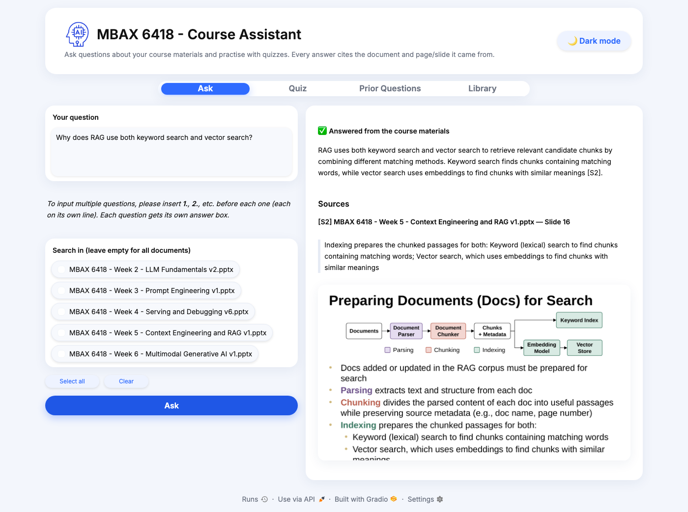
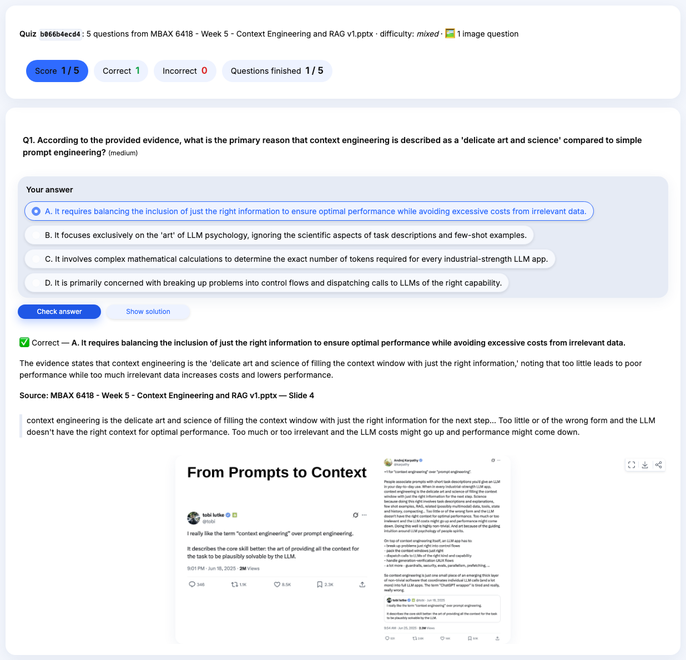
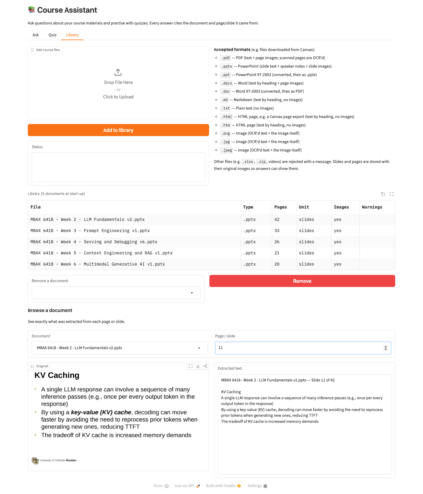

# Course Assistant: Q&A and Practice Quizzes from Course Materials

**MBAX 6418, Assignment 2**

A Python + Gradio app that answers questions about course materials (slides, syllabus, and other Canvas downloads) and generates multiple-choice practice quizzes from them. Every answer and every quiz explanation shows the **document**, the **page/slide**, a **quoted excerpt**, and the **original slide image**. When the materials don't contain the answer, the app says so instead of guessing.

Under the hood it uses **hybrid RAG** (retrieval-augmented generation: find relevant material first, then have the model answer from it). It runs keyword search, text-embedding search, and image-embedding search over separate indexes, merges the results, reranks them with a multimodal reranker, and checks each answer's citations before showing it.



---

## Contents
- [What it does](#what-it-does)
- [Accepted file formats](#accepted-file-formats)
- [Setup](#setup)
- [Running the app](#running-the-app)
- [How it works](#how-it-works)
- [Testing](#testing)
- [Results and findings](#results-and-findings)
- [What was tested and what wasn't](#what-was-tested-and-what-wasnt)
- [Limitations](#limitations)
- [Working on this as a team](#working-on-this-as-a-team)
- [Glossary](#glossary)

---

## What it does

| Tab | What a student can do |
|---|---|
| **Ask** | Ask a question about all documents or just the ones they pick. They get a short answer with `[S1]`-style markers. Each cited source shows the document, the slide/page, the quoted excerpt, and the original slide image. If the answer isn't in the materials, the app says it couldn't find it. |
| **Quiz** | Pick documents, optionally add a topic filter (e.g. "KV cache"), and choose 1–10 questions. Each multiple-choice question has 4 options. Solutions stay hidden until the student clicks **Check answer** or **Show solution**. The student then sees right or wrong, an explanation, the source excerpt, and the source slide image, with a running score. |
| **Library** | Upload files, see which formats are accepted and why a file was rejected, remove documents, and browse any page or slide to see the original image next to the text that was extracted from it. |

| Quiz feedback | Library browser |
|---|---|
|  |  |

More screenshots: [a question the materials can't answer](docs/screenshots/ask_not_found.png), [a freshly generated quiz with answers hidden](docs/screenshots/quiz_new.png).

## Accepted file formats

| Format | What is kept |
|---|---|
| `.pdf` | Text per page plus a rendered image of every page. Pages with no text layer (scans) are OCR'd. |
| `.pptx` | Slide titles, text, tables, **speaker notes**, plus an image of every slide (rendered with LibreOffice). |
| `.ppt`, `.doc`, `.docx` | Converted to PDF with LibreOffice, then handled like a PDF. If LibreOffice is missing, `.docx` falls back to text split by heading. |
| `.md`, `.txt`, `.html`/`.htm` | Text split into sections by heading. HTML is for Canvas page exports; scripts and navigation are removed. No images. |
| `.png`, `.jpg`, `.jpeg` | The image itself plus its OCR'd text. |

Anything else (`.xlsx`, `.zip`, videos, …) is rejected with a message listing the accepted formats.

Every page image is OCR'd (OCR: reading text out of an image). When the image contains text that the file's text layer lacks, such as diagram labels, screenshots of tables, or charts, that text is stored separately as **visual text**, which can be searched and quoted, and the original image is sent along with it as evidence.

## Setup

Requires Python 3.12 (installed for you by `uv`) and, for slide and page images, LibreOffice.

```bash
git clone https://github.com/kritter6754/assignment2_MBAX6418.git
cd assignment2_MBAX6418

# 1. Python dependencies (uv: https://docs.astral.sh/uv/)
uv sync

# 2. LibreOffice, used to render PPTX/DOCX pages as images
brew install --cask libreoffice          # macOS
# sudo apt install libreoffice           # Ubuntu/Debian

# 3. Configuration: copy the example and fill in the class endpoint details
cp .env.example .env
# edit .env: set CLASS_API_KEY and the *_BASE_URL values from the class
```

`.env` is git-ignored. **Never commit it**, and never paste the key into code, issues, screenshots, or chat. `.env.example` contains only dummy values.

| Variable | Service (class endpoints at `dobolyi.com`, ports 9001–9005) |
|---|---|
| `LLM_BASE_URL`, `LLM_MODEL` | Vision-capable LLM (`Qwen3.6-35B-A3B`): answers, quizzes, support checks |
| `TEXT_EMBED_*` | Text embeddings (`Nemotron-3-Embed-1B`) |
| `VISUAL_EMBED_*` | Image/text embeddings in a shared space (`Qwen3-VL-Embedding-2B`) |
| `RERANK_*` | Multimodal reranker (`Qwen3-VL-Reranker-2B`) |
| `OCR_*` | Document parsing / OCR (`dots.mocr`) |
| `TEXT_EMBED_QUERY_PREFIX`, `TEXT_EMBED_PASSAGE_PREFIX` | Defaults `"query: "` / `"passage: "`. These prefixes matter a lot; see [findings](#results-and-findings). |

## Running the app

```bash
# Load a folder of course files (or use the Library tab's upload instead)
uv run python scripts/ingest_folder.py ~/path/to/Canvas/downloads

# Start the app at http://127.0.0.1:7860
uv run course-assistant
```

Loading the five course decks (142 slides) takes about 3 minutes, mostly OCR and image embeddings. Documents are stored under `data/` (git-ignored) and stay there between runs. A typical answer takes 2–4 seconds and a 5-question quiz about 10 seconds.

### Always-on hosting (Railway)

The app runs on [Railway](https://railway.com), so it stays up when everyone's laptops are off. The server image contains the code and the prepared library (slide images, extracted text, search indexes), built from your local `data/`. The server never sees the original course files, and none of this goes to GitHub.

First time (one person):
```bash
railway login                       # opens a browser
railway init -n course-assistant    # creates the Railway project
scripts/deploy_railway.sh           # copies .env settings to Railway, builds, uploads
railway domain                      # creates the public https://...up.railway.app address
```

To redeploy after code or library changes, run `scripts/deploy_railway.sh` again. Other teammates run `railway link` once first.

- **Settings live in Railway variables.** The script copies them from `.env` through stdin, so the key never appears in a command, a log or the image.
- **The hosted app is read-only and needs the login** (`APP_USERNAME`/`APP_PASSWORD`). It refuses to start on a public host without a password.
- **Saved quizzes on the server are lost on each redeploy.** Library changes are made locally, then redeployed.
- Railway charges about $5 a month after its free trial credit.

### Sharing a public link

To let classmates use the app running on your computer:

```bash
# in .env
SHARE=true
APP_USERNAME=mbax
APP_PASSWORD=<pick a password>

uv run course-assistant      # prints "Running on public URL: https://xxxx.gradio.live"
```

Send classmates the link and, separately, the username and password.
- **The link only works while your computer is awake and the app is running.** Gradio keeps it for up to a week (best effort); each restart creates a new link.
- **Read-only by default.** When shared, upload and remove are left out of the interface entirely, so visitors can ask questions, take quizzes and browse documents, but can't change the library. Set `READ_ONLY=false` to override.
- **A password is required.** The app refuses to start with `SHARE=true` and no `APP_PASSWORD`, because an open link would let anyone use the class API through your key.
- Everyone with the link uses the class endpoints with your key, and sees the instructor's slides.

## How it works

```
                 ┌─────────────── ingest (per file) ──────────────────────────────┐
 course file ──▶ │ parse text  ─┬─▶ chunks (never cross a page; keep doc/page/   │
                 │ render pages │    section/offset) ──▶ keyword index (bm25s)    │
                 │ OCR images ──┘                     └─▶ text vectors (Chroma)   │
                 │ page images ─────────────────────────▶ image vectors (Chroma)  │
                 └────────────────────────────────────────────────────────────────┘
 question ──▶ keyword top-20 ┐
              text-vector top-20 ┴─ RRF merge ─┐
              image-vector top-8 ──────────────┴─▶ multimodal reranker ─▶ best 8 evidence items
                                                   (text chunks + page images, ≤3 image hits)
          ──▶ vision LLM (JSON: found / answer / sources[{id, quote}])
          ──▶ format check (pydantic, 1 retry)
          ──▶ source check: cited id was retrieved AND quote appears on that page
              (in the page text, the OCR'd visual text, or a fresh OCR of the page)
          ──▶ support check: a second LLM call, which sees the cited excerpts and images,
              judges whether they back every claim. If not: one regeneration, then a warning.
          ──▶ { answer, sources[] }, or "couldn't find this in the materials"
```

| Module | Responsibility |
|---|---|
| [`course_assistant/ingest.py`](course_assistant/ingest.py) | File parsing, page rendering, OCR, the accepted-format list |
| [`course_assistant/chunking.py`](course_assistant/chunking.py) | `langchain-text-splitters` recursive chunking, page-by-page |
| [`course_assistant/library.py`](course_assistant/library.py) | Storage plus the three **separate** indexes (bm25s, Chroma `text_chunks`, Chroma `page_images`) |
| [`course_assistant/retrieval.py`](course_assistant/retrieval.py) | Hybrid search, reciprocal rank fusion, reranking, evidence selection |
| [`course_assistant/answer.py`](course_assistant/answer.py) | Answer prompt, structured output, source and support checks |
| [`course_assistant/quiz.py`](course_assistant/quiz.py) | Quiz generation and validation, fixed answer key, grading |
| [`course_assistant/services.py`](course_assistant/services.py) | HTTP clients for the five class services (retries, key redaction) |
| [`course_assistant/app.py`](course_assistant/app.py) | Gradio interface |

**Structured output.** The LLM is constrained to a JSON schema (vLLM structured outputs) with separate `answer` and `sources` fields, and pydantic validates it. The app returns an `AnswerResult` with `answer`, `sources` (document, location, excerpt, image), `status` (`answered` / `partially_supported` / `not_found` / `error`), and `notes` describing any citations that were dropped.

**Quizzes have a fixed answer key.** Each generated question must have 4 distinct options, a correct index in range, and a cited source whose quote really appears on that page; questions that fail are discarded. Options are shuffled with a seed, so the right answer isn't always "A". The quiz is saved once to `data/quizzes/<id>.json` together with a SHA-256 hash of its answer key. It is never overwritten, and loading it re-checks the hash. The browser only receives a quiz id plus the questions and options. Answers and explanations are sent only after a student checks or reveals a question.

**Keeping keys secret.**
- The key is read only on the server, from `.env`.
- It is sent only in the `Authorization` header and is hidden from `repr()`.
- It is replaced with `[REDACTED]` in every service error and log line.
- It never reaches the browser.

Tests check each of these, and the UI walkthrough checks the page HTML for leaks.

## Testing

| Command | What it checks | Needs the class services? |
|---|---|---|
| `uv run pytest` | **43 offline tests** using fake services: ingestion of every format family, chunk offsets and boundaries, quote matching, retrieval and doc filters, answer validation (fabricated quotes, unknown ids, malformed JSON retry, unsupported claims, not-found), visual evidence, quiz validation, fixed key, tamper detection, hidden answers, grading, secret redaction, `.gitignore`, no key in tracked files | No (runs in GitHub Actions on every push and PR) |
| `uv run pytest -m live` | 3 smoke tests against the real LLM, embeddings, reranker and OCR | Yes |
| `uv run python scripts/ui_walkthrough.py` | Drives the running app in a headless browser: asks an answerable question and an unanswerable one, generates a quiz and confirms answers are hidden before checking, checks one answer and reveals another, verifies the score, browses the library, checks the page for secrets, and saves the screenshots in `docs/screenshots/` | Yes (app running) |
| `uv run python eval/run_eval.py` | The benchmark below. Writes [`results/summary.md`](results/summary.md) and [`results/eval_results.json`](results/eval_results.json) | Yes |
| `uv run python eval/prefix_ablation.py` | The embedding-prefix comparison below. Writes [`results/prefix_ablation.json`](results/prefix_ablation.json) | Yes |

## Results and findings

**Benchmark:** 35 questions about the five MBAX 6418 slide decks (Weeks 2–6), listed in [`eval/questions.jsonl`](eval/questions.jsonl). Each answerable question lists the slide(s) that answer it.
- 20 **text** questions: the answer is in the slide text.
- 9 **visual** questions: the answer is only in a diagram, chart, table screenshot or tweet image.
- 6 **unanswerable** questions: e.g. the final-exam date or LoRA, which the slides don't cover.

### Final results (`results/summary.md`)

Retrieval: is a correct slide among the top-k evidence items? (29 answerable questions)

| Mode | hit@1 | hit@3 | hit@8 | MRR | visual hit@3 |
|---|---|---|---|---|---|
| **hybrid** (keyword + text vectors + image vectors, reranked) | **1.00** | **1.00** | 1.00 | **1.00** | **1.00** |
| hybrid without reranker (RRF only) | 0.90 | 1.00 | 1.00 | 0.94 | 1.00 |
| text vectors only | 1.00 | 1.00 | 1.00 | 1.00 | 1.00 |
| keyword only (BM25) | 0.83 | 0.97 | 1.00 | 0.90 | 0.89 |

End to end: the full app (retrieve, answer, check), comparing the hybrid design with a text-vector-only baseline that uses the same answering and checking steps.

| Design | Answered **and** cited a correct slide | Visual questions: same | Unanswerable correctly refused | Made-up answers to unanswerable questions | Median time |
|---|---|---|---|---|---|
| **hybrid** | **29/29 (1.00)** | **9/9** | **6/6** | **0** | 2.3 s |
| text vectors only | 27/29 (0.93) | 7/9 | 6/6 | 0 | 1.3 s |

### How the design changed, and why (measured on the same benchmark during development)

| Step | Change | Hybrid: answered + correct slide | Text-only: same | Visual questions (hybrid) |
|---|---|---|---|---|
| 1 | First full version | 0.90 | 0.52 | 0.78 |
| 2 | Added `query:` / `passage:` prefixes to text embeddings | 0.93 | 0.69 | 0.78 |
| 3 | OCR every slide image; store OCR text the text layer lacks as separate "visual text" chunks; send the slide image with them; keep a diagram description as visual evidence if the support check passes | 0.97 | 0.90 | **1.00** |
| 4 | Work around vLLM dropping `<\|im_start\|>`-style tokens from output; count Week 3 slide 7 as a correct source for the ChatML question | **1.00** | 0.93 | 1.00 |

Rows 1–3 were recorded from development runs; only the final run is saved in `results/`. In step 4, the ChatML question's correct-slide list was widened after seeing the results, because slide 7 also lists those tokens. Without that change, hybrid would score 28/29.

### Findings
1. **The design choice compared: an embedding-model detail mattered more than the search architecture.** With no prefixes, text-vector-only retrieval found a correct slide in the top 3 for just 55% of questions. With the `query:`/`passage:` prefixes the model expects, it found one for 93% ([`results/prefix_ablation.json`](results/prefix_ablation.json); hit@1 went from 0.41 to 0.83). Before the fix, "hybrid beats text-only" looked like a big win. Most of that gap was a misconfigured baseline.
2. **Reranking helps most at the very top.** Without the reranker, hybrid hit@1 drops from 1.00 to 0.90. The reranker is the only component that scores text chunks and slide images against each other.
3. **Visual questions needed OCR of slide images.** Many slides keep their content in images: the prompting-techniques table, diagrams, tweets, Google Trends charts. Before step 3, the app said "not in the materials" for 2 of the 9 visual questions even though the right slide had been retrieved. In one case the model only saw the slide's text, which didn't include the table. In the other, the model described a diagram's arrows rather than quoting it, so the citation check rejected the answer.
4. **The citation checks catch real problems.** Across development runs they rejected unverifiable citations and flagged partly supported answers. For example, "few-shot gives *many* examples" was flagged because the slide says "one or many". The final run made no false claims on unanswerable questions.
5. **A serving quirk:** vLLM strips chat-template control strings (`<|im_start|>`) from model output, even with `skip_special_tokens=false`. Course material that is *about* chat templates needs the look-alike workaround in [`services.py`](course_assistant/services.py).

## What was tested and what wasn't

**Tested (automated, passing as of the last run):**
- the 43 offline tests (including password and read-only checks for sharing);
- the 3 live service smoke tests;
- the browser walkthrough of all three tabs;
- the 35-question benchmark.

**Tested manually:** a few dozen ad-hoc questions and several quizzes on the Week 2–6 decks; checking the screenshots.

**Not checked yet:**
- **Real PDFs, DOCX, and Canvas HTML/syllabus files.** Each format family is covered by unit tests with generated files, but only `.pptx` has been tested end to end with real course files (we don't have a syllabus file yet).
- **Scanned PDFs on the real OCR service.** OCR was exercised only through slide images and a fake in the unit tests.
- **Quiz quality at scale.** Quiz *validity* is enforced automatically (format, source, quote), but nobody has systematically reviewed whether questions are pedagogically good or whether the distractors are fair.
- **The benchmark is small and was written by the same person (Claude) who built the system,** after reading the slides, so question wording overlaps heavily with the slides. The perfect hybrid scores mostly show that this benchmark is too easy now. Teammates should add harder, paraphrased questions.
- **Run-to-run variation.** The LLM runs at temperature 0, but the server's outputs still vary slightly between runs (e.g. whether a borderline answer is flagged as partly supported). Each benchmark configuration was run once.
- **Multiple users at once, very large libraries (thousands of pages), Windows, and accessibility.**

## Limitations
- **Embedded videos** in slides render as blank frames (e.g. Week 2, slide 37), so their content can't be searched.
- **OCR text is used for search and for verifying quotes, but OCR can misread.** Answers that rely on OCR'd text or on a diagram show the original image, so students can check them.
- **"Visual evidence" sources** are labelled *"Model's reading of the image"* when the model describes a diagram instead of quoting it. Those depend on the LLM support check rather than an exact text match.
- **Partial answers:** the model sometimes answers "not found" when the slides cover only part of a question, instead of giving the partial answer.
- **Secret redaction replaces the literal key value in logs and errors.** Because the class key is a short number that also appears in the course code, redacted logs may show `MBAX [REDACTED]`.
- **The library is built on one machine.** Page images and indexes live in `data/` locally, and the hosted copy is a snapshot taken at deploy time. To change the hosted library, ingest locally and redeploy.
- **Course slides are the instructor's material.** `data/` is git-ignored, so slide files and page images are not committed. The README screenshots do show slide content.

## Working on this as a team
- **Branches:** one per issue, e.g. `git switch -c feat/12-syllabus-pdf`. Keep `main` working.
- **Commits:** small, with a clear summary line (50 characters or fewer).
- **Pull requests (PRs):** open one per branch and write "Closes #12" in the description, so merging closes the issue. Another teammate reviews it. The GitHub Actions check (`tests`) must pass before merging.
- **Before a PR:** run `uv run pytest`. If you changed retrieval or prompts, also run `eval/run_eval.py` and commit the updated `results/`, so the effect is visible in review.
- **Never commit** `.env`, `data/`, or course files. `.gitignore` covers these, and a test checks that the key isn't in tracked files.

Open tasks are tracked as GitHub issues with completion checks.

## Glossary
- **RAG (retrieval-augmented generation):** look up relevant material first, then have the LLM answer using only that material.
- **Chunk:** a short passage of a page (here up to about 900 characters), the unit that search returns.
- **Embedding:** a list of numbers representing meaning, so texts (or images) with similar meanings have nearby vectors. **Vector search** finds the nearest ones.
- **BM25 / keyword search:** a classic ranking by matching words, weighted by how rare they are.
- **RRF (reciprocal rank fusion):** merges ranked lists by giving each item `1/(60 + rank)` points per list.
- **Reranker:** a model that reads the question together with each candidate and scores how well that candidate answers it. Slower but more accurate than embeddings.
- **OCR:** optical character recognition, reading text out of an image.
- **Structured output:** forcing the LLM's reply to match a JSON schema.
- **hit@k / MRR:** whether a correct slide is in the top *k* results, and the average of 1/(rank of the first correct slide).
- **CI (continuous integration):** GitHub runs the tests automatically on every push and pull request.
